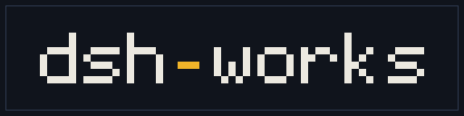

<p align="center">
  
</p>

<p align="center">
  <em>A small workshop for <a href="https://github.com/deepseek-ai/deepseek-harness">DeepSeek Harness</a> plugins: private by default, with the workbench and the rulebook open.</em>
</p>

Two of us, one bench, and a growing pile of things that make the harness feel less like a chat
box and more like a place you work in. A drawing surface that can look at its own art. A creature
in the corner with opinions. A bell that rings when the agent is done, and tells you what the
afternoon cost. And a workbench that keeps all of it current across two machines.

Most of the plugin code here is private. The rulebook, this page and [viburnum](https://github.com/dsh-works/viburnum)
are public — the door, not the mystery. That is deliberate: the process and the tools nobody should
have to reinvent are open, and the half-finished plugin experiments stay a workshop until they are
ready.

## What's here

| Plugin | Repo | What it is | Version |
| :---------- | :------------------- | :---------------------------------------------------------------------------------------------------------------------------------------------------------------------------------------------------------------------------------------- | :-----: |
| **viburnum** | `viburnum` | A sync button for your own linked plugin checkouts across two machines: a sidebar dot, a page, `vib_*` tools and a `vib` CLI. Public, MIT, open for contributions. | `0.1` |
| **Pixel Art** | `dsh-plugin-pixelart` | Four `pixelart_*` tools and a live sidebar tab. The model draws a character grid, sees the image, gets a critique, and draws it again — pixel art with a feedback loop. There is no image-generating model anywhere in it. | `0.4` |
| **Pip** | `dsh-plugin-pip` | A 32×32 creature that lives in the corner of the window: walks, dozes, thinks along with the composer, celebrates a landed turn, and occasionally has to run from the police. 25 spritesheets, 113 frames, one spring-loaded antenna. | `1.3` |
| **Alerts** | `dsh-plugin-alerts` | A chime, a desktop notification and a tab-title marker when a turn finishes or the agent needs you — with that run's duration, tokens and estimated cost. The same arithmetic, quietly, as a pill beside every reply. | `0.4` |

All four are real bundles: a host half, a browser half, a `cordis.patch.yml`, tests, and a
README that says what the thing cannot do.

## The rulebook

[`dsh-plugin-development`](https://github.com/dsh-works/dsh-plugin-development) is public: the skill
and process every plugin here is built against — plan gates, bundle shape, the standards, the
templates, and a lessons ledger. The
[repository taxonomy](https://github.com/dsh-works/.github/blob/main/REPO-TAXONOMY.md) says what a
repository in this org is — plugin, skill, process or profile — and each repository wears its kind
as a GitHub topic.

It is public because a process nobody can read is a rumour, and because `viburnum` is built to be
used by people outside this workshop too.

## On the bench

- **Something for the filesystem.** Currently a sentence and a feeling.
- **Hand editing in the pixel art panel.** The plugin reviews, reopens and exports drawings; it
  does not paint them yet. That is §4.5 of its `SCOPE.md`, and it stays there until it is good.
- **One more thinking reaction in Pip.** Its README declines to describe it. So do I.

## How a plugin gets built here

Every repo has roughly the same shape, so moving between them is boring in the good way.

```
dsh-plugin-<name>/
├── index.js            host entry: name, inject, Config, apply
├── lib/                the actual work, one concern per file
├── client.js           the browser half: panel, cards, everything alive
├── cordis.patch.yml    the bundle row a profile mounts
├── test/               node:test, offline: no model, no network
├── scripts/check.mjs   the mechanical half of the house standard
└── README.md           what it does, what it doesn't, and why
```

The rules, such as they are:

- **`npm run check` is the gate.** Checker, lint, format, tests. Red means not done.
- **`node:*` before a dependency.** The PNG encoder is 200 lines, the GIF encoder is one file,
  and the sprite sheets are baked by a script that checks its own output.
- **The tests are the interesting part.** They are where you find out whether the thing you drew
  is the thing that renders.
- **The README is part of the plugin.** Limits get a section, not a footnote.
- **Open where it matters, private by default otherwise.** MIT when it ships, the rulebook in the
  open, no telemetry, and writes stay inside the workspace.
- **`main` is stable, `dev` is where work happens.** Features cut from `dev`; a hotfix cuts from
  `main` and merges back into both. The full branch model is in the skill.

## First ten minutes

1. Get the harness running — `dsh web` from a checkout of
   [deepseek-harness](https://github.com/deepseek-ai/deepseek-harness). Node 22 or 24; the bundles
   declare `dsh ^0.2.1-rc.2` as a floor, not a promise.
2. Clone whichever repo you want — `viburnum` is the one anyone can install and contribute to.
3. Install it as a bundle: `dsh plugin --profile web add <absolute path>`, or `plugin_manager` →
   `install_bundle` from a session. Then check the package landed in **both** `dependencies` and
   `dsh.profile.bundles` — a `link:` on its own mounts nothing.
4. Restart `dsh web` if it says to. Browser halves come back with the page; host halves do not
   come back without a restart.
5. Read the plugin's README before its source. It is shorter than it looks.

## Why an organization

Because inviting a friend to one repository at a time, again, every time, is a chore that gets
worse with each repository. Here the invite happens once, most plugin code stays private, and
nobody has to remember which link to send.

Most of it is not a product. `viburnum` is the first piece built to be installed by anyone; the
rest is a workbench with a door open to people we like — and, for the workbench itself, to anyone
with the same two-machine problem.

---

<sub>Built for [DeepSeek Harness](https://github.com/deepseek-ai/deepseek-harness). The pixel art
plugin has 255 offline tests and no runtime dependencies. Pip has a shadow, a mood and a memory.
The alerts plugin knows what your afternoon cost. viburnum keeps the checkouts honest on both
machines.</sub>
